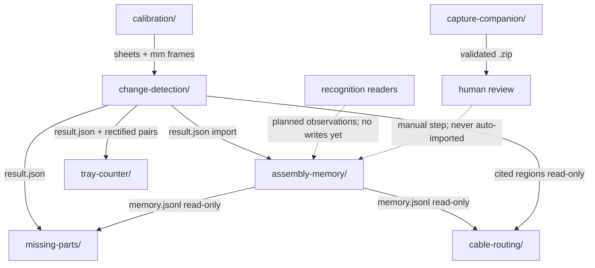

# ANASTYLOS architecture

Evidence-backed visual assistance for electronics disassembly and
reassembly. Every module reports *observations with provenance*, never
bare claims: millimetre coordinates cite their calibration, verdicts
stay `unknown`/`ambiguous` when evidence is weak, and nothing is
confirmed without explicit operator confirmation.

No real-hardware validation has been performed: all vision results
below come from synthetic fixtures and unit tests.

## Design rules (observed, keep them)

- Append-only memory: `assembly-memory` events are never edited or
  deleted; corrections append a new event with `supersedes`.
- Read-only analyzers: integrators read detection output and (for
  `missing-parts` and the `cable-routing` graph only) memory logs,
  but never write back to them; they write only to their own
  `--out` dir. `tray-counter` reads detection output only.
- Explicit epistemics: recognizers return `ok` / `ambiguous` /
  `unknown` with reasons; candidates never self-promote.
- Stable tiers: `assembly-memory` and the capture validator are
  standard-library-only; vision modules use the pinned
  OpenCV + NumPy environment (`calibration/requirements.txt`).
- Offline: Python has no network imports; the capture PWA's only
  network use is same-origin service-worker caching of its app shell.
- Licensing is deliberately deferred: no root `LICENSE` file, no
  project license declared anywhere. Agent operating rules live in
  versioned [`AGENTS.md`](AGENTS.md); personal agent notes stay local
  (`AGENTS.local.md`, gitignored).

## System boundaries and subsystems

```text
calibration/  ── sheets + px/mm frames ──> change-detection/
change-detection/ ── result.json + rectified pairs ──> tray-counter/
                                                  ──> missing-parts/
                                                  ──> assembly-memory (import)
readers/ - - planned observations (future; no reader writes to memory yet) - → assembly-memory/
assembly-memory/ + change-detection/ ──> cable-routing/ (read-only graph)
capture-companion/ ── validated .zip packages ──> (human review; never
    auto-imported into Core memory)
```

Five subsystems, one evidence philosophy:

- **Spatial foundation** (`calibration/`, `change-detection/`): printed
  millimetre frames and planar before/after comparison. Produces the
  `result.json` evidence artifact everything downstream cites.
- **Memory core** (`assembly-memory/`): the append-only log of what was
  removed from where. Standard-library-only; the stability anchor.
- **Recognition experiments** (resistor/smd/screw-reader/
  screw-measurement/polarity/washer/pcb-ocr/markings/fingerprints/
  connectors readers): independent single-purpose CLIs. None writes
  to memory yet — see "Actual integration status".
- **Integrators** (`tray-counter/`, `missing-parts/`, `cable-routing/`
  graph): read-only consumers that combine detection output (and, for
  `missing-parts` and the graph, memory logs) into higher-level
  candidates. Never write back.
- **Capture edge** (`capture-companion/`): offline phone PWA plus a
  stdlib-only package validator. Human-reviewed staging only.



## Module / status index

Status definitions (hygiene gate 01):

- `implemented`: code and relevant isolated tests exist.
- `integrated`: code is part of `main` (or this hygiene branch's
  inherited `main` history) and cross-module verification has been
  performed where applicable.
- `hardware-validated`: the capability passed documented tests using
  real physical hardware and genuine images. Synthetic tests never
  count. Nothing below has this status.

Integration baseline: five feature branches
(`feat/capture-companion`, `feat/cable-routing`, `feat/missing-parts`,
`feat/polarity`, `feat/screw-measurement`) merged via
`integrate/feature-batch` into `main` at `20be578`
(`fix(integration): stabilize feature-batch verification gates`).
Verification at that commit: 750 Python module/validator tests (746
passed; 1 failure + 3 errors — all 4 are calibration tests needing
native Cairo/poppler on Windows, see limitation 1), plus the
5-test compliance-checker self-suite (755 Python test methods in
total when the checker suite is counted); 66/66 capture frontend unit tests
executed; TypeScript compilation (`tsc`) and the production build
(`vite build`) also clean — those two are static checks, not test
executions. The compliance check reported 0 errors with 8 open
review items (8 SPDX annotations, grouped into 6 narrative items in
`THIRD_PARTY_NOTICES.md`). No real-hardware validation reported.
This hygiene branch is docs-only, so it inherits those results;
test counts below are per-module
(`python -m unittest discover -s tests` from the module directory
unless noted) and match the current tree's test methods exactly.

| Module | Responsibility | Entry point | Status | Tests |
|---|---|---|---|---|
| `calibration/` | printable sheets, ChArUco, px/mm frames | `generate.py` | integrated | 13 run, 9 pass (1 failure + 3 errors need native Cairo/poppler; known Windows gap) |
| `change-detection/` | planar before/after change check | `detect.py` | integrated | 3 pass + synthetic selftest 16/16 |
| `assembly-memory/` | append-only disassembly memory, where-goes queries | `memory.py` | integrated | 21 pass |
| `resistor-reader/` | resistor color-code reader (experimental) | `read.py` | integrated | 30 pass |
| `tray-counter/` | tray addition/removal candidates | `count.py` | integrated | 14 pass |
| `pcb-ocr/` | silkscreen reference-designator extraction (needs OCR engine) | `ocr.py` | integrated | 31 pass |
| `smd-reader/` | SMD marking decoder (reuses pcb-ocr) | `smd.py` | integrated | 31 pass |
| `screw-reader/` | screw-head drive classifier | `screw.py` | integrated | 45 pass |
| `component-markings/` | component marking recognition | `markings.py` | integrated | 54 pass |
| `component-fingerprints/` | visual fingerprint enroll/match gallery | `fingerprints.py` | integrated | 61 pass |
| `connector-matching/` | plug/socket mating-geometry match | `connectors.py` | integrated | 68 pass |
| `screw-measurement/` | calibrated screw geometry (top/side) | `measure.py` | integrated | 81 pass (incl. 3 `_hex_widths` regression tests) |
| `polarity-reader/` | polarity/orientation markers + rules | `polarity.py` | integrated | 60 pass |
| `washer-spacer/` | washer/spacer recognition + classifier | `washer.py` | integrated | 82 pass |
| `missing-parts/` | missing/displaced-part candidates | `missing.py` | integrated | 81 pass |
| `cable-routing/` | cable paths + assembly-order graph | `cable.py` | integrated | 53 pass |
| `capture-companion/` | offline-first capture PWA + validator | app + `python/anastylos_capture_validate.py` | integrated | TS 66 pass, `tsc` clean, `vite build` ok; validator 22 pass |
| `tools/compliance/` | third-party inventory checker (SPDX) | `check.py` | integrated | 5 pass; `check.py`: 0 errors, 8 open reviews |

Hardware-validated: none. Every vision claim above rests on synthetic
fixtures; see each module README for its stated validation scope.

## Stable data interfaces

- Detection `result.json`: `status` (`no_change`, `single_change`,
  `multiple_changes`, `registration_invalid`, `view_mismatch`,
  `input_error`), `view`, `rectified.px_per_mm`, `regions[]` with
  `label`, `bbox_mm`, `centroid_mm`. Every file embeds
  `harness_config_sha256` (canonical hash of the parameter set) and
  `kit_config_sha256` (bytes hash of the calibration config); the
  per-file `result_sha256` is NOT embedded — it is computed
  downstream: `assembly-memory import` and `missing-parts` hash the
  file bytes at read time, the `cable-routing` graph reuses the
  hash recorded in memory evidence, and `tray-counter` cites file
  paths without hashing. Consumed verbatim by `tray-counter`,
  `missing-parts`, `cable-routing`, and `assembly-memory import`.
  `registration_invalid` covers unconfirmed views, cross-group
  views, and failed registration; `view_mismatch` only covers a
  before/after view change within one view group (see
  `change-detection/README.md` for the exact conditions).
- Memory log: `<session>/memory.jsonl`, one JSON event per line
  (`observation` / `tray_link`), SHA-256 file provenance, coordinates
  stored verbatim and never transformed.
- Memory event contracts: `observation` carries `source_view`,
  `bbox_mm`, `centroid_mm`, and an evidence reference (`result_json`,
  `pair_id`, `region`, plus the file's SHA-256 when on disk) or a
  manual basis; `tray_link` binds an observation to a tray cell with
  the tray snapshot (`sheet_id`, `number`, `rect_frame_mm`) resolved
  from `calibration/calibration-config.json` at record time, plus either an
  evidence basis or a human confirmation — anything else is rejected
  and nothing is written. Queries answer `located` / `ambiguous` /
  `unknown` / `unassigned`, never a bare claim.
- Calibration JSON: two key spellings share one physical meaning
  (image pixels per millimetre) and are NOT interchangeable across
  modules — `pixels_per_mm` (`screw-measurement`, which adds
  `pixels_per_mm_std` and `frame`, plus `cable-routing`,
  `polarity-reader`, `washer-spacer`)
  versus `px_per_mm` (`pcb-ocr`, `component-fingerprints`,
  `connector-matching`, `missing-parts`, plus the rectified
  detection output itself). Each module validates its own input.
  Do not invent a unified schema without a migration.
- Capture package (schema v1, `capture-companion/SCHEMA.md`):
  manifest + assets zip; mirrored TypeScript/Python validators must
  keep agreeing (round-trip test enforces this). Every interpreted
  field carries an epistemic state (`observed` / `interpreted` /
  `suggested` / `confirmed` / `unknown`); only the operator can set
  `confirmed`, and quantities are never inferred from photo counts.

## Coordinate systems and calibration semantics

Several coordinate kinds exist; every measurement states which one
it uses. There is no single universal convention — the statements
below are per kind:

- Source image pixels: origin top-left, +x right, +y down. The
  modules that name a pixel convention (`cable-routing`
  `coordinate_convention`, `polarity-reader`, `washer-spacer`) all
  use this one; the remaining crop readers report source-frame
  pixels or boxes without restating the origin. Angles, where
  reported (`polarity-reader`, `washer-spacer`), run clockwise
  from +x in degrees over [0, 360).
- Rectified detection millimetres: `change-detection` warps each
  pair onto a millimetre grid for one named view (`rectified.view`,
  `rectified.px_per_mm`, `rectified.origin_frame_mm`). Frame axes
  are x right, y down per
  `calibration/calibration-config.json`; the named frame origins
  are the top-left of marker 0 (`surface_a4`), 10 (`surface_a3`),
  20 (`fixture_front`), and 30 (`fixture_back`).
- Operator-supplied calibration millimetres: readers convert
  pixels to mm only from a validated `--frame-meta` /
  `--calibration` file with provenance, using their own spelling
  (`pixels_per_mm` vs `px_per_mm` — see "Stable data interfaces"
  for the per-module inventory).
- Connector-local housing coordinates are the exception: contact,
  keying, and latch positions live in a housing-fixed canonical
  frame (rotation-invariant), not in image pixels; millimetre
  pitch additionally needs a frontal mating face and valid
  `px_per_mm`.
- View identifiers double as frame identifiers for the four
  detection sheets (`surface_a3`, `surface_a4`, `fixture_front`,
  `fixture_back`). `charuco_board` is calibration-only: its sheet
  carries no ArUco registration markers, the detector reads only
  `DICT_5X5_100`, and the harness `view_groups` list just the
  four sheets — so detection never reports it as a view.
  `screw-measurement` additionally accepts `custom:<name>` frames.
- Front and back share no transform.
- Homographies are exact on the paper plane only; controller/part
  height is unmeasured, so off-plane content suffers uncorrected
  parallax. The camera must stay fixed between before/after shots.
- Millimetres appear in a result only with cited, validated
  calibration (frozen `change-detection/harness-config.json` + kit
  SHA-256 for detection; `--frame-meta` / `--calibration` files
  with provenance elsewhere). Without it: pixels plus an explicit
  error or null — never silently converted pixels. Never change
  these semantics without a migration and a version bump of the
  affected contract.

## Current dependency relationships

Code-level (Python imports across module boundaries) — only these:

- `cable-routing` → `assembly-memory` (`graph.py` lazily imports
  `anastylos_memory.store` for read-only log loading).
- `smd-reader` → `pcb-ocr` (`anastylos_pcb.backends`,
  `anastylos_pcb.pipeline` — public reuse, no second OCR engine).
- `component-markings` → `pcb-ocr` (same seam).
- `assembly-memory/tests` → `change-detection` (integration test
  drives the synthetic harness; test-only).

File-contract coupling (no imports; consumers read produced files):

- `change-detection` reads `calibration/calibration-config.json` via
  the pinned path + SHA-256 in `change-detection/harness-config.json`.
- `assembly-memory` reads the kit config for tray-cell resolution
  and imports detection `result.json` files verbatim.
- `tray-counter` reads detection `result.json` files (+ rectified
  images) only; `missing-parts` reads detection output plus
  `memory.jsonl` (reconcile); the `cable-routing` graph reads
  `memory.jsonl` plus the cited detection regions. All three read
  verbatim; none imports producer code.

No other cross-module imports exist (verified by search). In
particular `missing-parts` and `tray-counter` consume files only,
`connector-matching` and `component-fingerprints` share patterns but
no code, and the capture validator is dependency-free. Keep it that
way: new coupling goes through versioned file contracts, not imports.

## Detection and interpretation flow

1. `calibration/` prints the physical reference; its config pins
   marker geometry and tray zones with a SHA-256 identity.
2. `change-detection/` registers before/after pairs onto that frame,
   writes rectified images and `result.json` (regions in mm,
   embedding the harness canonical hash and the kit bytes hash).
   The parameter set is frozen by canonical hash: `canonical_sha256`
   over the parsed harness JSON (`json.dumps` with sorted keys,
   compact separators, UTF-8 — see
   `change-detection/anastylos_diff/config.py`).
3. Recognition readers classify tight crops independently
   (`ok`/`ambiguous`/`unknown` + reasons); all stop at their own
   `--out` dir today and none writes to memory.
4. `assembly-memory import` turns cited `result.json` regions into
   append-only observations (hashing each file's bytes into
   `result_sha256` evidence at import time); operators add tray
   links and manual observations with confirmation.
5. Read-only integrators derive candidates (tray add/remove, missing
   parts, assembly-order graph) without mutating their inputs.
6. Anything promoted toward "confirmed" requires an operator
   confirmation artifact — see below. Capture packages wait in human
   review and are never auto-imported.

## Operator confirmation requirements

These fields/transitions require explicit human confirmation and must
never be set by analysis code:

- `assembly-memory` `tray_link` without an evidence basis needs
  `--confirmed-by`; `where` answers never invent a location.
- `missing-parts` `confirmed_missing` arises only from an external
  confirmation file, never from images.
- `cable-routing` graph `confirmed` edges need a confirmations file
  with `confirmed_by` per edge; unknown ids are reported, not added.
- `tray-counter` `proposed_links` always carry
  `requires_confirmation: true`.
- Capture `confirmed` category/quantity/review states are set only by
  operator action in the inspector; identification candidates stay
  `suggested`.
- `measured_print_scale`, `--mapping` files, and frame-metadata
  scales are operator-owned evidence: wrong input, wrong output, and
  the module must not second-guess them.

## Offline and future AI-provider boundaries

- Python is fully offline: no network, HTTP, or cloud imports
  anywhere (verified by search). The PWA's only network use is
  same-origin service-worker caching of its app shell.
- Future models plug in behind narrow, documented seams — all
  currently unimplemented, advisory-only by contract:
  - `missing-parts`: `run_comparison(..., aligner, segmenter)`
    callables; `screw-measurement`: `analyze(..., segmenter)`;
    `screw-reader`, `polarity-reader`, `washer-spacer`:
    `segmenter`/`ranker`/`detector` callables.
  - `component-fingerprints`: `EmbeddingProvider` vectors (cosine
    similarity, named + versioned); `connector-matching`:
    `AssistantProvider` advisory notes; `component-markings`:
    `assistant` callable whose notes are recorded verbatim.
  - Capture: provider-neutral `IdentificationProvider` interface
    (`app/src/lib/identify.ts`); the registry is empty and the UI
    labels identification as future functionality.
- Seam contract: providers may add evidence or notes, never change a
  verdict, never confirm an identity, never call the network from
  Python. No Meta Muse / SAM integration, automated BOM sourcing, CAD
  reconstruction, or live sync exists — do not document any as
  present.

## Actual integration status

What "integrated" concretely means today — and does not:

- Does mean: all modules merged to `main`, shared `.venv`
  environment, per-module suites green (except the 4 known
  Cairo/poppler calibration cases), cross-module file contracts
  exercised (`assembly-memory` ⇄ `change-detection` integration
  test; capture TS↔Python round-trip test), compliance inventory
  consistent.
- Does not mean: a single runnable pipeline. There is no top-level
  orchestrator, no shared runner, and no end-to-end real-photo run.
  All recognizers write only to their own `--out` dir and none
  writes to memory; wiring them into memory import is future work
  requiring per-module contract decisions — not a bulk edit. The
  only producer paths into `memory.jsonl` today are
  `assembly-memory import` (change-detection `result.json`) and the
  manual `record observation` / `record tray-link` commands; the
  only read-only consumers of the log are `missing-parts`
  reconcile and the `cable-routing` graph.

## Reproducible test commands

Python (from the repo root; `.venv` per `calibration/README.md`):

```powershell
cd <module>; ..\.venv\Scripts\python -m unittest discover -s tests
.venv\Scripts\python change-detection/detect.py selftest --seed 20261026
py -3.12 tools/compliance/check.py   # stdlib-only; no venv needed
```

Capture PWA (from `capture-companion/app`, after `npm ci`):

```powershell
npm test        # vitest
npm run typecheck
npm run build   # vite production bundle -> app/dist/
```

Run each Python suite from its own module directory: several suites
share test file names (`test_eval.py`, `test_vision.py`), so a single
repo-root pytest collection collides. Per-module unittest discovery is
the documented runner.

Test methodology: deterministic synthetic fixtures (fixed seeds,
hand-built detection pairs, stub OCR backends) prove pipeline
self-consistency and contract conformance only — never real-hardware
accuracy. Real-photo evaluation harnesses (`eval` subcommands with
hand labels) exist per module but no labelled real-photo set exists
yet. Known validation gaps: zero real images scored anywhere; capture
camera/install/offline behavior verified by inspection + build checks,
not on devices; calibration print masters unmeasured
(`measured_print_scale` unset).

## Integration limitations and remaining work

1. Calibration kit tests (4 of 13: 1 failure + 3 errors) need native
   Windows components outside `requirements.txt`: `libcairo-2.dll` on
   `PATH` (PDF/PNG generation) and poppler `pdftoppm` on `PATH`
   (test-only PDF rasterizing). Product code degrades gracefully to
   SVG with a warning. Setup is documented in
   `calibration/README.md`; committed print/preview fixtures are
   intact and consistent.
2. `pixels_per_mm` vs `px_per_mm` key spellings differ by module
   (per-module inventory under "Stable data interfaces"). No live
   incompatibility; unify only with a migration.
3. npm transitive closure licenses unverified (compliance review
   item); direct capture devDeps are MIT/Apache-2.0 per installed
   metadata.
4. No end-to-end real-hardware run exists. Synthetic selftests and
   fixtures do not substitute for it.
5. Current priority: real-hardware validation and end-to-end demo
   readiness — print and measure the calibration sheets, photograph a
   real disassembly, score the `eval` harnesses on labelled real
   photos, and run the capture manual checklist on a physical phone
   (see `capture-companion/README.md`).
